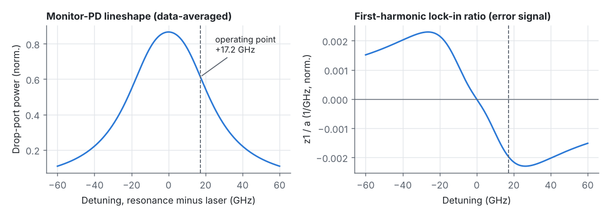
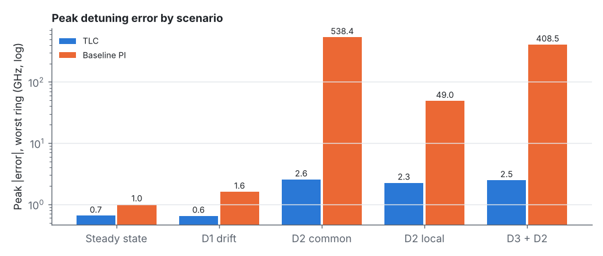
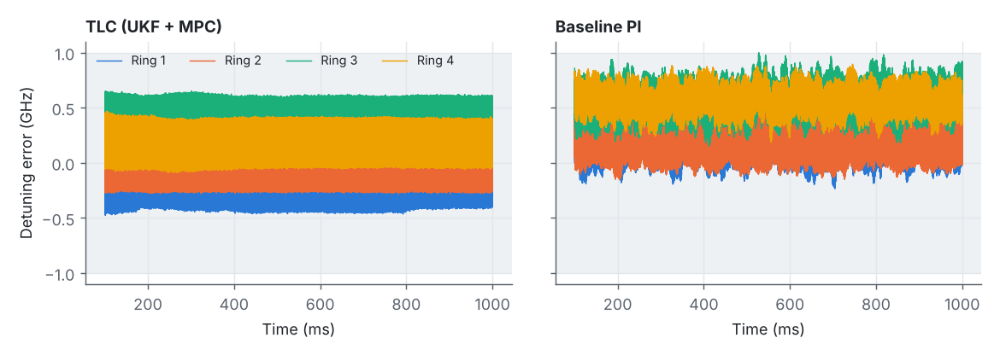
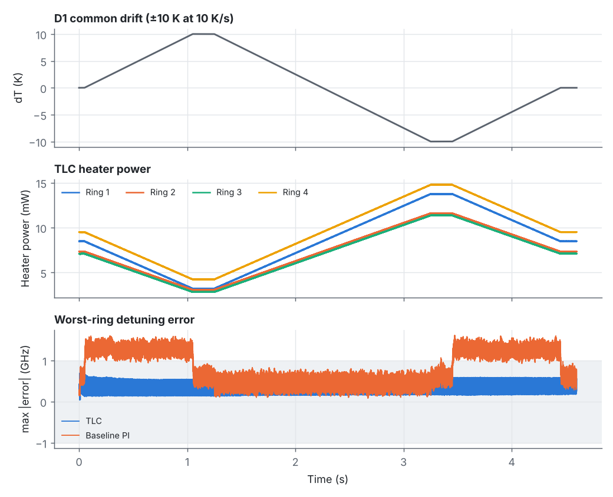
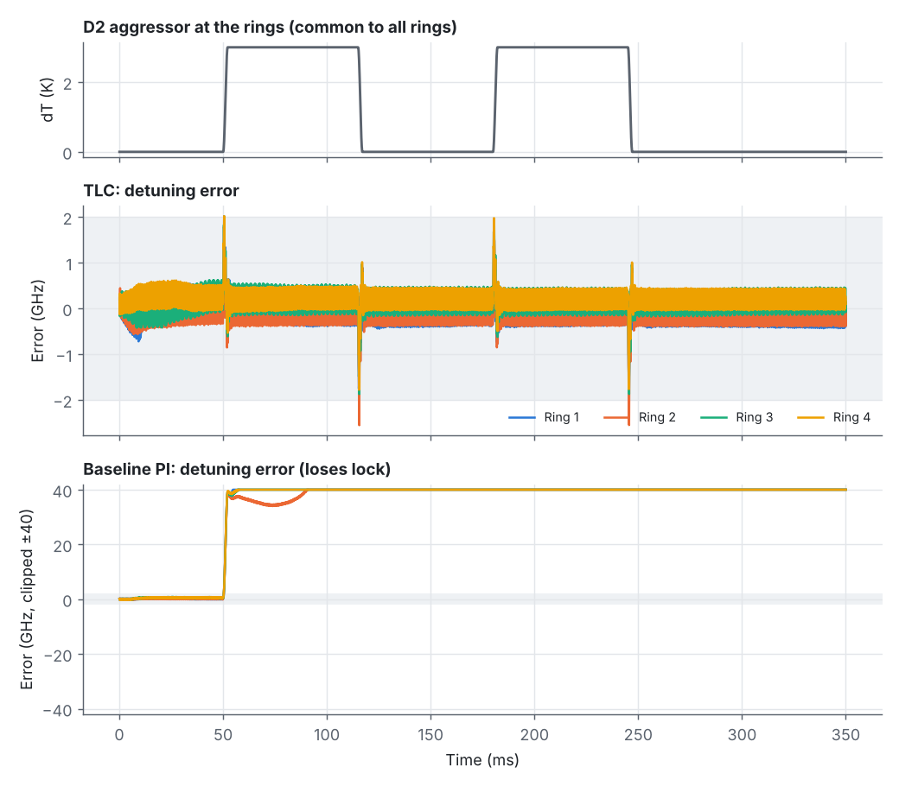
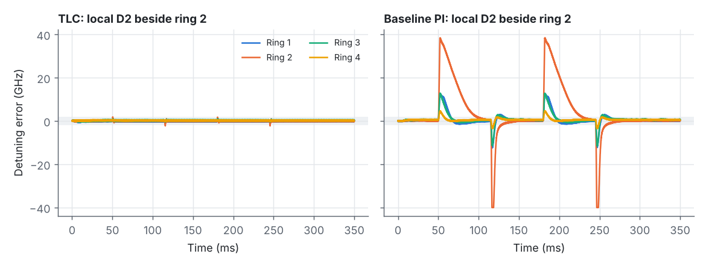
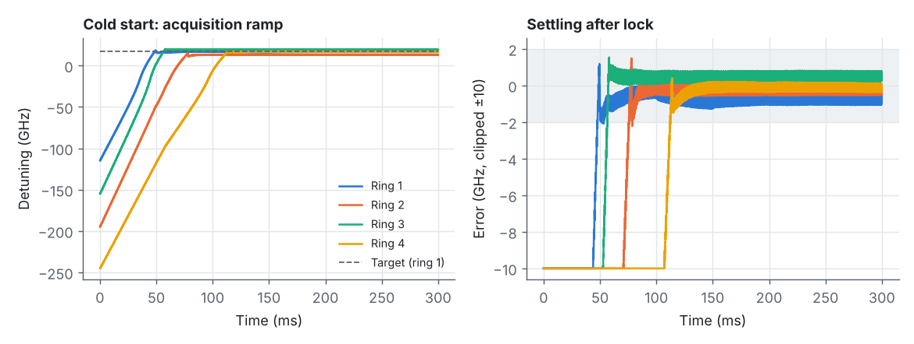
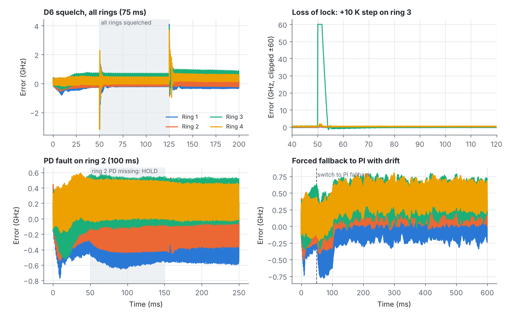
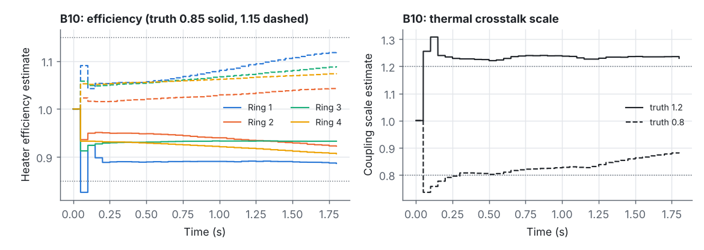

# Microring Thermal Control: Simulation Report

October 2026

## Summary

I implemented the proposal's thermal locking controller (TLC) in Python, covering blocks B1–B10 with a UKF estimator and a horizon-20 MPC. I also built a plant model of the four-ring transmitter for it to control. The plant has six thermal paths per ring (constants from ref \[4\]), thermal crosstalk, nonlinear optical self-heating, a data-averaged drop-port monitor PD with realistic noise and 12-bit quantisation, and the D1–D6 disturbances.

**Headline results (true detuning error):**

- **Steady state and D1 drift:** error stays within 0.65 GHz (R1/R2 limit: 2 GHz).
- **D2 aggressor:** peak error is 2.6 GHz with the TLC (limit 6 GHz). The baseline PI loses lock outright, because its 4 ms lock-in is too slow for D2's edges.
- **Robustness cases:** squelch, loss of lock, PD dropout, fallback switch, start-up and 1.5× disturbances all meet their requirements. The 40-trial random cold-start campaign had no wrong-channel locks.
- **Not met:**
  - A ±3 dB laser-power change. The ±2.5 % in the spec is fine. The failure is an observability limit of drop-port-only sensing.
  - R13's ER window. It is infeasible for this lineshape at ±6 GHz.

Both are explained in Results, with a suggested fix.

The main assumption to confirm: I read D2 as a **3 K swing at the rings** with the published peak rates. Taken literally, Table II's numbers would be hundreds of kelvin.

## Control system implemented

The `tlc/` package implements the thermal locking controller (TLC) block by block as in the proposal, one module per block. It runs at the 10 kHz control rate (Ts = 100 µs). In each step it consumes 100 PD samples per ring and emits ten heater commands per ring, one per 10 µs, which form the 100 kS/s command stream.

| Block | What the code does |
| --- | --- |
| **B1 Dither** | Puts one sinusoidal tone per ring on the heater command: 2.0, 3.0, 3.5 and 4.5 kHz. These sit on a 250 Hz grid, so over the 4 ms window each tone, its 2nd harmonic and every 2nd-order intermodulation product falls in a separate bin, and all are away from the 10 kHz update ripple. The amplitude is scheduled between 0.1 and 0.5 GHz peak detuning from the estimator's uncertainty, then converted to a command amplitude using the modelled heater response at that tone. |
| **B2 Conditioner** | 31-tap FIR low-pass (150 kHz), decimation by 2 to 500 kS/s, and validity flags for NaN, stuck and saturated samples. It also gives a running noise estimate, used both as the measurement quality score and to recognise squelch: the data-pattern noise disappears when modulation stops. |
| **B3 Lock-in** | Hann-windowed, 4 ms sliding I/Q demodulation at every tone. Outputs the DC level y0, the own-tone first and second harmonics y1 and y2, and the cross-tone responses used by B10. The phase of each tone is calibrated online while tracking. |
| **B4 UKF** | Twelve states: detuning δ, drift rate r and PD DC scale p for each of the four rings. Prediction uses the reduced thermal model with the commands actually applied. There are two measurement channels. The first is the ratio ζ = y2/y1, which is independent of laser power and PD gain and anchors δ. The second is the per-block DC level, a fast channel that covers the 4 ms lock-in latency during D2 edges and includes the known dither wobble from all tones. The drift-rate process noise is shaped as common mode plus two spatial gradients plus a local term. Robustness: Huber-style soft gating, adaptive process noise, outlier rings that update only their own states, a physical bound on the rate state, held rings decoupled and propagated on the model, and the DC scale frozen during squelch. |
| **B5 Supervisor** | Finite-state machine with states INIT, ACQUIRE, TRACK, HOLD, REACQUIRE and FAULT. ACQUIRE ramps the heater at 2 GHz/ms from the short-wavelength side and locks when the normalised slope crosses its model value at the operating point. Loss of lock is declared after 1.5 ms of a large estimated error, wrong-side slope or persistent gating. REACQUIRE backs off 120 GHz and re-ramps. Invalid PD data moves a ring to HOLD with its command frozen. |
| **B6 Setpoints** | Targets the zero-curvature point on the long-wavelength flank, about +17 GHz, where optical self-heating acts as negative feedback. Within ±4 GHz it shifts each target to balance OMA across rings, subject to an extinction-ratio check over ±2 GHz. |
| **B7 MPC** | Horizon 20 (2 ms) on the reduced thermal model, coupled across all four rings. Cost = tracking error + heater power + command increments. Box constraints \[0, guard\] are enforced by projection, and the R19 slew limit by a soft penalty. Solved with a 25-iteration fast gradient method, with matrices cached per mode mask. The estimated drift rate is fed forward with a 0.93 per-step decay. |
| **B7 PI fallback** | Per-ring PI on the lock-in error with back-calculation anti-windup. The supervisor switches to it on a fault with a bumpless transfer. The same PI, run on its own, is the baseline controller used in the comparisons. |
| **B8 Output** | First-order hold of the new command plus dither, clamped to \[0, 1\]. Slew is limited to 0.6 % FS per 10 µs sample, below the R19 limit of 10 %/ms, leaving margin for dither. A channel guard limits travel to 200 GHz past the target. The applied, slew-limited command is fed back to the model. |
| **B9 Diagnostics** | 100 Hz status log and an alarm list (locked, loss\_of\_lock, pd\_invalid, heater limit, acquire\_failed). |
| **B10 Calibration** | Recursive least squares on heater efficiency from the measured vs. modelled lock-in slope, and on the crosstalk scale from neighbour-tone responses. Updates are committed to the model every 50 ms with the model state kept continuous. |

### Reduced model inside the controller

The controller's model treats the fast heater path as algebraic. It keeps the slow heater path and the crosstalk path as first-order states, with gains linearised around the operating point including the self-heating loop gain.

## Plant model: what is simulated

The plant (`plant.py`) is a coupled thermal–optical model of the four-ring WDM transmitter described in the proposal, standing in for the hardware the TLC would control. Each ring has a heater, a laser on a 400 GHz grid, an NRZ modulator drive and a drop-port monitor photodiode. The controller sees only the 12-bit PD samples at 1 MS/s and outputs heater commands; everything below is internal to the plant.

### Thermal network (per ring)

The temperature rise of ring i is the sum of six first-order paths, with structure and constants from the proposal's reference \[4\] (Cherian et al.), extended to four coupled rings:

$$
T_i = T^{HF}_i + T^{HS}_i + T^{X}_i + T^{SF}_i + T^{SS}_i + T^{E}_i + \Delta T^{dist}_i,\qquad \tau_k\,\dot T^{k}_i = -T^{k}_i + R_k\,P^{k}_i
$$

| Path | Input power | R (K/W) | τ | Source |
| --- | --- | --- | --- | --- |
| HF: heater, fast | own heater | 1135 | 13 µs | ref \[4\] |
| HS: heater, slow | own heater | 410 | 78 µs | ref \[4\] |
| X: thermal crosstalk | other heaters: 20 % / 6 % / 2 % of their self-heating at 1 / 2 / 3 positions | (via HF+HS) | 250 µs | assumed |
| SF: optical self-heating, fast | absorbed laser power | 465 | 1.7 µs | ref \[4\] |
| SS: optical self-heating, slow | absorbed laser power | 2440 | 7.7 µs | ref \[4\] |
| E: modulator driver heating | 0.1 mW, removed during squelch | 2905 | 0.2 µs | ref \[4\], power assumed |

The heater command u ∈ \[0, 1\] maps linearly to power, with 25 mW full scale, giving about 580 GHz of self-tuning range. Absorbed optical power is 30 % of the laser power times the data-averaged lineshape. That makes self-heating nonlinear in detuning, which is the source of thermal bistability.

### Optics

The resonance detuning from the ring's own laser is

$$
\delta_i = \delta^{0}_i + \kappa\,T_i - \lambda^{shift}_i,\qquad \kappa = 15\ \mathrm{GHz/K}
$$

Here δ⁰ is the unheated fabrication offset (about −250 GHz by default) and λ\_shift is the D4 laser drift. Each ring is a Lorentzian with a half-width of 19–21 GHz and a through-port dip depth of 0.93–0.96, with a small spread across rings. The 53 GBd NRZ drive shifts the resonance by ±8 GHz (m). The PD is far slower than the symbol rate, so it sees the average of the two shifted Lorentzians, weighted by the fraction of ones f₁ in each 1 µs sample:

$$
L_{avg}(\delta) = f_1\,\mathcal{L}(\delta+m) + (1-f_1)\,\mathcal{L}(\delta-m),\qquad \mathcal{L}(\delta) = \frac{1}{1+(\delta/\gamma)^2}
$$

f₁ fluctuates around 0.5 with binomial statistics, which gives realistic data-pattern noise. During squelch (D6), m = 0 and that noise disappears. Each drop PD also picks up the Lorentzian tails of the other three lasers, FSR-periodic with an assumed FSR of 2 THz.

### Monitor PD chain

The PD chain adds white TIA noise (4×10⁻⁴ of full scale rms), quantises to 12 bits, and clips to the ADC range. Faults can be injected as missing samples (NaN), a stuck value, or saturation.

### Integration

The plant steps at 1 µs. Heater commands are held for 10 µs, which is the 100 kS/s command stream. Each 10 µs sub-block uses the exact exponential solution of every path. Optical self-heating is evaluated at the predicted mid-sub-block detuning (semi-implicit), so the bistable feedback is not artificially delayed by the hold.

### Disturbances (proposal Table II)

- **D1:** slow common temperature ramp.
- **D2:** fast on-die aggressor, a periodic swing at the published +2200 / −2300 K/s peak rates, applied to all rings or locally with a spatial decay of 1 / 0.35 / 0.12 / 0.04.
- **D3:** uneven static offsets.
- **D4:** laser wavelength offset and drift.
- **D5:** ±3 dB laser power change.
- **D6:** modulation squelch.
- **Faults:** temperature kicks (for loss-of-lock tests) and PD faults.

## Results

Every scenario in proposal App. C.1 was run in closed loop against the plant. Durations are shortened (see Assumptions). "Error" always means the **true** detuning minus its target, taken from the plant, not the controller's estimate. Where it makes sense, the TLC is compared with the baseline PI controller. All numbers come from `results/metrics.json`.

### Requirement check

| Req | Test (as simulated) | TLC result | Baseline PI | Status |
| --- | --- | --- | --- | --- |
| R1 | Steady state, 1 s | p99.9 ≤ 0.64 GHz | 0.97 GHz | ✅ |
| R2 | D1 ±10 K at 10 K/s, 4.6 s | p99.9 ≤ 0.60 GHz | 1.57 GHz | ✅ |
| R3 | D2 common / local (ring 1, ring 2) / with D3 | peak 2.6 / 2.1 / 2.3 / 2.5 GHz | 538 GHz (lock lost) | ✅ |
| R4 | Back to ≤ 2 GHz after D2 ends | immediately (never above 2 GHz afterwards) | 103 ms | ✅ |
| R5 | Laser offsets ±20 / ±35 GHz + drift | p99.9 ≤ 0.92 GHz | – | ✅ |
| R6 | Other rings, local D2 | ≤ 0.97 GHz | 12.9 GHz | ✅ |
| R7 | Laser power ±2.5 % (spec) | p99.9 ≤ 1.03 GHz after; ≤ 3.0 GHz peak with D2 | – | ✅ |
| R7 stress | Laser power ±3 dB (App. C row) | +3 dB: 14 GHz bias; −3 dB: all rings lose lock and relock off target | – | ❌ see below |
| R8 | Cold start, 115–260 GHz short | locked at 49 / 78 / 58 / 114 ms | – | ✅ |
| R8 | Restart ring 3 while others run | ring 3 locked in 18 ms; others ≤ 2.9 GHz | – | ✅ |
| R9 | Random cold starts (offsets, lasers, ambient) | 0 wrong-channel locks in **40** trials; lock median 71 ms, max 139 ms | – | ✅ (40 of 1,000) |
| R10 | +10 K step on one ring (150 GHz) | detected 1.8 ms, relocked 4.8 ms; neighbours ≤ 1.9 GHz | – | ✅ |
| R11 | D2 + D3 at 1.5× | peak 4.2 GHz, no recovery needed, 0 wrong channel | – | ✅ |
| R12 | 75 ms squelch, all rings / one ring | peak 3.2 / 3.2 GHz; ≤ 2 GHz within 1.3 ms of restart | 5.3 GHz | ✅ |
| R13 | ER ≥ 3.5 dB over ±6 GHz | infeasible with this lineshape; met over ±2 GHz | – | ❌ (design issue) |
| R19 | Command range and slew | 0–1 always; max slew 10.0 %/ms | – | ✅ (at the limit) |
| R21 | Ring 2 PD missing for 100 ms | command change 0.0 %; error ≤ 0.66 GHz | – | ✅ |
| R22 | Forced switch to PI fallback | step 0.005 % FS; error ≤ 0.8 GHz | – | ✅ |
| O5 / B10 | Heater efficiency 0.85 / 1.15, crosstalk 1.2 / 0.8 | learned 0.89–0.93 / 1.04–1.12, crosstalk 1.23 / 0.88; D2 peak ≤ 5.0 GHz | – | ✅ |

### Steady state and slow drift (R1, R2)

Both controllers hold steady state comfortably. The visible band of about ±0.3 GHz in the traces is the dither itself, which deliberately wobbles the true detuning. Under D1 the TLC's drift-rate feedforward keeps the error inside 0.6 GHz. The PI's integrator lags the ramp and sits at 1.3–1.6 GHz.

### Fast aggressor D2 (R3, R4, R6)

This is the case that justifies the architecture. Each D2 edge moves the resonance by about 45 GHz in roughly 2 ms. The baseline's 4 ms lock-in cannot see that in time, so the ring falls off the flank and the PI runs away (500+ GHz, a loss of lock). The TLC's fast DC-level channel and its UKF drift-rate state let the MPC counter-heat within a few hundred microseconds. Peak error is 2.6 GHz, and there is no recovery transient. A local D2 is contained: the neighbouring rings stay under 1 GHz.

### Start-up and acquisition (R8, R9)

From heaters off, each ring ramps at 2 GHz/ms from the short-wavelength side, recognises the long-wavelength flank from the lock-in slope, and hands over to the UKF/MPC. All rings lock between 49 and 114 ms, and settle within ±1 GHz. Across the 40-trial campaign there were no wrong-channel locks and no failures, with a maximum lock time of 139 ms.

### Events and faults (R10, R12, R21, R22)

- **Squelch:** detected from the disappearance of data-pattern noise. The estimator switches to the unmodulated lineshape, giving a 3 GHz blip at each transition.
- **Loss of lock:** a +10 K step on one ring is detected in 1.8 ms. That ring re-acquires in 4.8 ms, and its neighbours never exceed 1.9 GHz. A 5 K step (75 GHz) is simply tracked through without losing lock.
- **PD fault:** a missing PD puts that ring in HOLD with its command frozen, then it resumes cleanly.
- **Fallback:** forcing the PI fallback mid-drift is bumpless.

### Online calibration (B10)

With the plant's heater efficiency or crosstalk off from the model by ±15–20 %, B10 recovers most of the error within about 50 ms. A residual bias of a few percent remains on efficiency, because the dither-slope estimate also absorbs lineshape mismatch. It stays inside the R22 envelope.

### What does not work: large laser-power changes

At the spec's ±2.5 % power change the TLC holds lock with under 1 GHz bias. At the App. C stress level of ±3 dB it does not. The cause is observability, not tuning. The monitor PD sees only the drop-port power, and optical self-heating scales with laser power. So "+3 dB of power and 14 GHz further off resonance" produces almost the same DC level and lock-in ratios as "nominal power, on target". I tried a power-independent second-harmonic anchor and a self-heating-aware lock-in model, and neither separates the two cases. A per-channel input-power tap (or using the laser's own power monitor) would give the estimator the missing measurement. That is the change I'd recommend to the design.

### Compute

The Python implementation takes about 3.3 ms per 100 µs control step, so these runs are not real-time. The MPC's 25 fast-gradient iterations on an 80-variable problem are about 160 k multiply-accumulates per step, which an FPGA DSP array can do within the 100 µs budget. That was not demonstrated here.

## Assumptions and defaults

Where the proposal left something open, I picked a default and kept going. These are the ones that matter most for interpreting the results.

1. **D2 amplitude at the rings.** Taken literally, Table II's D2 rates (+2200 / −2300 K/s) held for a full 130 ms period would mean hundreds of kelvin. I modelled D2 as a 3 K swing at the rings, the figure from R3's rationale, with raised-cosine edges that reach the published peak rates. **This is the assumption most worth confirming**, since it sets how hard the R3/R4 tests are.
2. **Heater command linear in power**, not in voltage, with 25 mW full scale. Thermal crosstalk is 20 / 6 / 2 % of a neighbour's self-heating at 1 / 2 / 3 positions, with a 250 µs time constant. Laser powers, PD full scale, noise levels and absorption fraction are also assumed. All are marked in `params.py`.
3. **Operating point on the long-wavelength flank** (+17 GHz, the zero-curvature point of the data-averaged lineshape). On this side optical self-heating is negative feedback, so the ring is thermally stable and heat-only control can always pull back.
4. **Low dither tones (2–4.5 kHz).** The R19 slew limit (10 % FS/ms) caps amplitude × frequency of the heater dither. At tens of kHz the required tone amplitude would use up the slew budget, so tones were moved down and the lock-in window lengthened to 4 ms. The cost is lock-in latency, which is why the fast DC-level channel was added to B4.
5. **Fast DC-level measurement in the UKF.** This is an addition beyond the proposal. A 4 ms lock-in alone cannot follow D2 edges, which move the resonance by about 35 GHz/ms. The DC level has 100 µs latency, and the power-independent ratio ζ keeps its scale calibrated.
6. **R13 (ER ≥ 3.5 dB) is checked over ±2 GHz, not ±6 GHz.** With a \~20 GHz half-width and ±8 GHz modulation shift, ER falls below 3.5 dB at 6 GHz from the operating point, so the ±6 GHz version is infeasible for this lineshape. A narrower ring or larger drive would fix it.
7. **Shortened durations.** D1 runs at 10 K/s (10× the design-basis rate) over ±10 K. The 24 h laser and power drifts are compressed into tens of ms. The test set covers proposal App. C.1 but with shorter runs.
8. **Timing.** Python takes about 3 ms per 100 µs control step, so the reported compute time does not represent FPGA timing. The MPC solve is about 25 iterations × 80×80 multiply-accumulates (\~160 k MAC per step). That is feasible on an FPGA DSP array, but O6 (compute budget) was not verified here.
9. **Baseline controller.** The baseline is the B7 PI fallback on its own, using the same 4 ms lock-in. Its D2 failure is partly that latency, not only the lack of a model.
10. **Not modelled:** TDEC and link-level metrics (R17), detailed driver electronics, and heater ageing beyond a static efficiency error. Heater-limit behaviour (R20) is flagged by the code but no scenario drives a heater to its limit.

## Code layout and how to run

See the [repository README](../README.md) for the file layout and run commands. Rings are numbered 0–3 in the code and 1–4 in this report.
